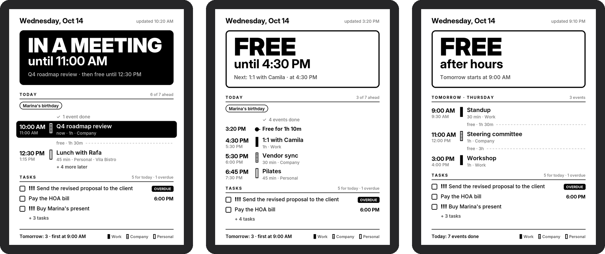
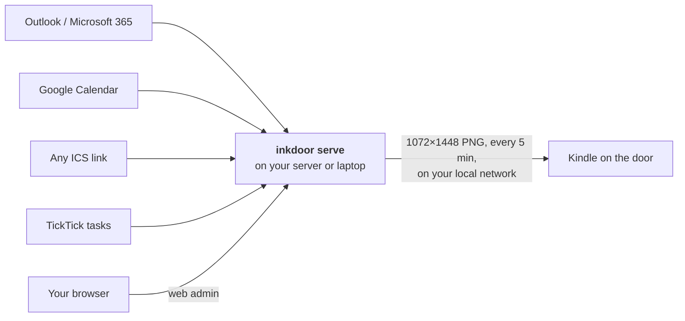
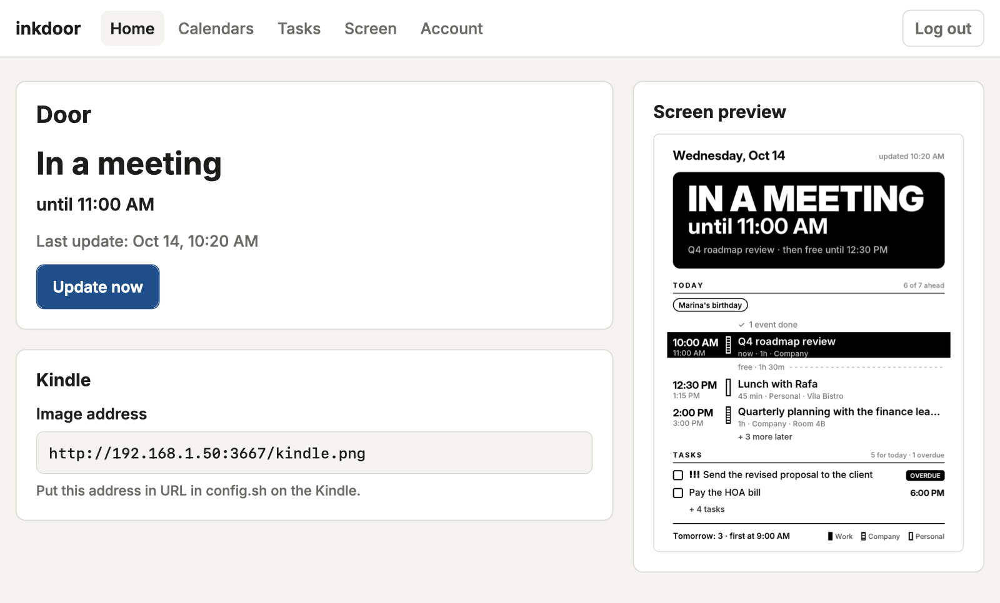

<div align="center">

# inkdoor

**Turn an old Kindle into a door sign that tells people whether you are in a meeting.**

[](https://github.com/frkey/inkdoor/actions/workflows/ci.yml)
[](LICENSE)
[](pyproject.toml)
[](#language)

**English** · [Português (Brasil)](README.pt-BR.md)

[Quick start](#quick-start) · [Documentation](#documentation) · [FAQ](#faq) · [Contributing](CONTRIBUTING.md)

</div>



<p align="center"><sub>Rendered with fictional data by <code>inkdoor demo</code>. The screen is also available in Brazilian Portuguese.</sub></p>

You work with the door closed, and people outside never know whether they can knock. inkdoor
reads all your calendars (Outlook, Google, any ICS link) and your TickTick tasks, and turns a
jailbroken Kindle into an e-ink sign that anyone can read from down the hall: **in a meeting
until 11:00 AM**, **free until 4:30 PM**, or **after hours**. On the same screen, you get your
whole day at a glance.

It runs on your own network. No cloud service and no account are involved: the calendars are
read by a small server in your home, and the image never leaves your LAN.

## Features

**At the door**

- A status readable from across the room, with the time it ends. Back-to-back meetings count
  as one block, so "until" is when you are really out.
- **It never guesses.** If a calendar cannot be read, the door reuses that calendar's last good
  data from today; with no data at all it says **Knock first**, never **Free**.

**For you**

- Today's events from every calendar, the free gaps between them, a *now* marker and the
  current event highlighted. After hours, the list switches to tomorrow.
- Tasks due today and overdue, with priority and time.
- Each calendar keeps its own marker (solid, striped, outline), since e-ink has no color.
  Calendars are never merged with each other.

**Easy to run**

- One command creates a ready Proxmox container; an installer covers any Debian or Ubuntu
  machine; or just `pip install` it on a laptop to try it out.
- A web admin: paste your calendar links, test them, and watch a live preview of the door.
- English and Brazilian Portuguese, with each language's clock (12-hour or 24-hour).

**Private by design**

- Calendar links are secrets: they stay on the server, are only ever shown shortened, and are
  never written to a log.
- The service runs as an unprivileged user in a locked-down systemd sandbox.

## How it works



- **The server** (`src/inkdoor`) is a small Python program. It reads the calendars, lays out the
  day and draws the screen as a 16-shade grayscale image, served over HTTP on your network.
- **The Kindle** (`kindle/`) runs two *scriptlets* that turn off its interface and show that
  image, downloading a fresh one every few minutes.

## Quick start

You need:

- a **jailbroken Kindle** that runs scriptlets (built on a Kindle Paperwhite 10th generation),
  and a charger;
- a machine that stays on, on the same network: a **Proxmox** host, any **Debian or Ubuntu**
  box (a VM, a mini PC, a 64-bit Raspberry Pi), or your laptop to try it;
- the **ICS links** of your calendars ([where to find them](docs/calendar-sources.md)).

### 1. Run the server

Pick one:

<details open>
<summary><b>Proxmox VE</b>: a ready container in one command</summary>

On the Proxmox host (the node's **Shell**, or SSH as root):

```bash
curl -fsSLO https://raw.githubusercontent.com/frkey/inkdoor/master/deploy/proxmox/create-lxc.sh
bash create-lxc.sh
```

It creates an unprivileged Debian container, installs inkdoor as a service and prints the
admin's address and password. Options (static IP, language, sizes): [docs/server.md](docs/server.md#proxmox-ve).

</details>

<details>
<summary><b>Debian or Ubuntu</b>: an installer for any machine</summary>

As root:

```bash
curl -fsSLO https://raw.githubusercontent.com/frkey/inkdoor/master/deploy/install.sh
bash install.sh
```

Same result as on Proxmox: a systemd service, the admin turned on, and its address and
password printed at the end. Details: [docs/server.md](docs/server.md#debian-or-ubuntu).

</details>

<details>
<summary><b>A laptop</b>: to try it out</summary>

Requires Python 3.10+.

```bash
git clone https://github.com/frkey/inkdoor.git
cd inkdoor
pip install -e .
cp config.example.toml config.toml   # paste your calendar links here
inkdoor check                        # tests every link
inkdoor serve                        # serves http://<this-computer>:3667/kindle.png
```

`inkdoor serve` must keep running for the door to update, and a laptop sleeps, so move to a
server once you like it. The admin is off on a laptop unless you
[turn it on](docs/server.md#on-a-laptop).

</details>

### 2. Add your calendars

Open the admin address the installer printed and log in with its password. In **Calendars**,
paste each ICS link and press **Test link**. **Home** shows the door exactly as the Kindle will.

<picture>
  <source media="(prefers-color-scheme: dark)" srcset="docs/img/admin-home-dark-en-US.png">
  
</picture>

### 3. Put it on the Kindle

1. Copy `kindle/inkdoor/` to the root of the Kindle and `kindle/documents/*.sh` to its
   `documents/` folder.
2. In `inkdoor/config.sh`, set `URL` to the address shown on the admin's home page, for example
   `URL="http://192.168.1.50:3667/kindle.png"`.
3. In the Kindle's library, open **inkdoor - test connection**, then **inkdoor - start display**.

Step by step, with tips on power and Wi-Fi: [docs/kindle.md](docs/kindle.md).

## Documentation

| Guide | What's in it |
|---|---|
| [Running on a server](docs/server.md) | Proxmox and Debian/Ubuntu install, updates, the web admin, opening it by name, security |
| [Setting up the Kindle](docs/kindle.md) | Jailbreak, copying the scripts, `config.sh`, using it day to day |
| [Calendar links](docs/calendar-sources.md) | Where to find the ICS link in Outlook, Google and TickTick, and how events are treated |
| [Troubleshooting](docs/troubleshooting.md) | What each door screen, Kindle message and Test link result means, and what to do |
| [Contributing](CONTRIBUTING.md) | Development setup, tests, translations, how changes are reviewed |
| [Security policy](SECURITY.md) | How to report a vulnerability, and what inkdoor protects |

## Configuration

Everything lives in `config.toml`, which the [admin](docs/server.md#admin) edits for you. Every
setting is explained in [`config.example.toml`](config.example.toml):

| Section | Settings |
|---|---|
| `[display]` | `language`, `timezone`, `clock`, `workday_start`, `workday_end`, `workdays`, `min_gap_minutes` |
| `[server]` | `port` (default 3667), `refresh_minutes` |
| `[[calendar]]` | one per calendar: `name`, `url`, `style` (`solid`, `striped`, `outline`), `busy` (whether it changes the door), `status_label` (the big word, e.g. `"Busy"` for personal events) |
| `[tasks]` | the TickTick subscription `url`, `overdue_days` |
| `[admin]` | `enabled` (off unless the installer turned it on), `allowed_hosts` ([opening the admin by name](docs/server.md#opening-the-admin-by-name)) |

> `config.toml` holds secret calendar links: anyone who has them can read your calendars. It is
> git-ignored, and on a server only the `inkdoor` user can read it.

## Commands

| Command | What it does |
|---|---|
| `inkdoor serve` | Renders the screen every `refresh_minutes` and serves it, with the admin, on `port`. Reloads the config on every cycle. |
| `inkdoor check` | Tests each link: reachable or not, how many events, whether titles come through or only "Busy". |
| `inkdoor render` | Renders `output/kindle.png` once. |
| `inkdoor demo 10:20 16:50` | Renders previews with fictional data; no calendars needed. |
| `inkdoor password` | Makes a new admin password, prints it once and logs out every browser. |
| `inkdoor url` | Prints the admin's address for other devices on the network. |

Global options: `--config path/config.toml`, `--output dir/`, `--lang en-US|pt-BR`. On a server,
the installed `inkdoor` command already points at the service's config.

## Language

The screen, the admin and every message are in **English (en-US)** by default, with **Brazilian
Portuguese (pt-BR)** built in:

```toml
[display]
language = "pt-BR"
```

Or pass `--lang pt-BR` to any command. Times follow each language's convention (12-hour for
en-US, 24-hour for pt-BR); set `clock = "24h"` or `clock = "12h"` to choose. Want another
language? See [Contributing](CONTRIBUTING.md#translations).

## Privacy and security

- **Keep it on your local network.** Never forward its port on your router: the image shows
  your schedule. The admin uses plain HTTP, so use it only on a network you trust.
- Only `/kindle.png` and the login page are public; every other page needs the admin login,
  which has a rate limit and CSRF protection. The server answers only to IP addresses and local network names, which
  blocks DNS rebinding.
- Links are fetched with a size cap and a deadline, and never to this machine's own loopback or
  link-local addresses.

More in [docs/server.md](docs/server.md#security). To report a vulnerability, see
[SECURITY.md](SECURITY.md).

## FAQ

<details>
<summary><b>Which Kindles work?</b></summary>

Any jailbroken Kindle that can run scriptlets (`.sh` files in `documents/`). inkdoor was built on
a Kindle Paperwhite 10th generation, whose screen is 1072×1448. For another resolution, change
`W` and `H` in `src/inkdoor/render.py`.
</details>

<details>
<summary><b>Does the Kindle need internet access?</b></summary>

No, only your Wi-Fi: it downloads the image from your server. The server is the one that needs
to reach the calendar providers.
</details>

<details>
<summary><b>Can it run on battery?</b></summary>

Not for long: the display keeps Wi-Fi on and does not use deep sleep, so keep the Kindle on a
charger. A thin USB cable fits through most door frames.
</details>

<details>
<summary><b>My company does not let me publish my Outlook calendar.</b></summary>

If only "Can view when I'm busy" is available, the door status still works and the list shows
"Busy" instead of titles. If publishing is turned off entirely, that calendar cannot be read
through an ICS link. See [Calendar links](docs/calendar-sources.md#microsoft-365--outlook).
</details>

<details>
<summary><b>What happens when my internet or a calendar is down?</b></summary>

The door keeps the last good data of that calendar for the rest of the day, and the footer says
which link failed. With no data at all for a calendar that marks you busy, it shows "Knock
first" instead of "Free".
</details>

<details>
<summary><b>How do I update?</b></summary>

Run the installer again: on Proxmox,
`pct exec <id> -- env LC_ALL=C.UTF-8 bash /opt/inkdoor/deploy/install.sh`; on Debian or Ubuntu,
`bash /opt/inkdoor/deploy/install.sh`. It never overwrites your config or your admin password.
</details>

## Contributing

Bug reports, ideas and pull requests are welcome. Start with [CONTRIBUTING.md](CONTRIBUTING.md):
it covers the development setup, the tests, the translation rules and how changes are reviewed.
Please never paste calendar links, names or meeting titles in issues; use fictional data.

## Credits

- The [Kindle Modding](https://kindlemodding.org/) community, for the jailbreaks and the
  scriptlet support this project builds on.
- [Inter](https://rsms.me/inter/) by Rasmus Andersson, the typeface on the screen (SIL Open Font
  License).
- [icalendar](https://github.com/collective/icalendar),
  [recurring-ical-events](https://github.com/niccokunzmann/python-recurring-ical-events),
  [Pillow](https://python-pillow.org/), [Flask](https://flask.palletsprojects.com/) and
  [Waitress](https://github.com/Pylons/waitress).

## License

[MIT](LICENSE). The Inter typeface is licensed under the [SIL Open Font License](src/inkdoor/fonts/OFL.txt).
