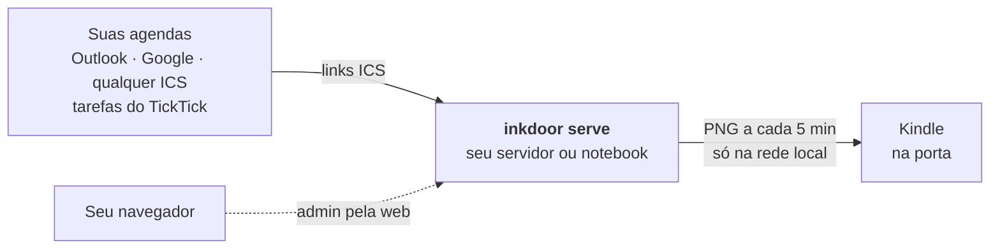
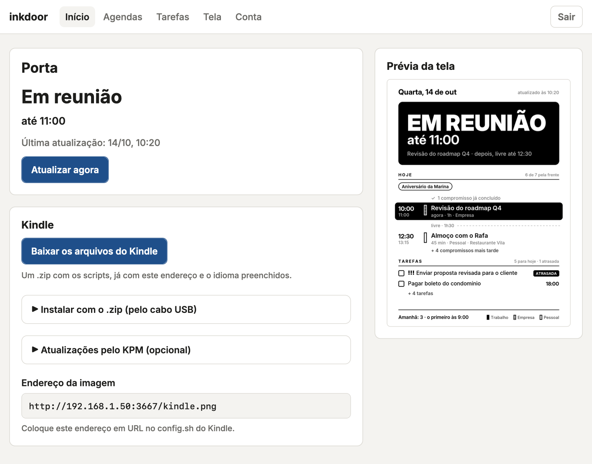

<div align="center">

# inkdoor

**Transforme um Kindle velho numa placa de porta que diz se você está em reunião.**

[](https://github.com/frkey/inkdoor/actions/workflows/ci.yml)
[](LICENSE)
[](pyproject.toml)
[](#idioma)

[English](README.md) · **Português (Brasil)**

[Começando](#começando) · [Documentação](#documentação) · [Perguntas frequentes](#perguntas-frequentes) · [Contribuindo](CONTRIBUTING.md)

</div>


<p align="center"><sub>Telas geradas com dados fictícios pelo <code>inkdoor demo --lang pt-BR</code>.</sub></p>

Você trabalha de porta fechada, e quem está do lado de fora nunca sabe se pode bater. O inkdoor
lê todas as suas agendas (Outlook, Google, qualquer link ICS) e as tarefas do TickTick, e
transforma um Kindle com jailbreak numa placa de e-ink que dá para ler do fim do corredor:
**em reunião até 11:00**, **livre até 16:30** ou **fora do expediente**. Na mesma tela, você vê o
seu dia inteiro.

Tudo roda na sua rede. Não há serviço na nuvem nem conta: as agendas são lidas por um servidor
pequeno na sua casa, e a imagem nunca sai da sua rede local.

## Recursos

**Na porta**

- Um status que dá para ler de longe, com o horário em que termina. Reuniões emendadas viram um
  bloco só, então o "até" é quando você realmente sai.
- **Ele nunca chuta.** Se uma agenda não pode ser lida, a porta reaproveita os últimos dados bons
  dela no dia; sem nenhum dado, mostra **Bata antes**, nunca **Livre**.

**Para você**

- Os compromissos de hoje de todas as agendas, as folgas entre eles, a marca de *agora* e o
  compromisso em andamento em destaque. Depois do expediente, a lista passa para amanhã.
- As tarefas de hoje e as atrasadas, com prioridade e horário.
- Cada agenda tem seu marcador (sólido, listrado, contorno), já que o e-ink não tem cor. As
  agendas nunca são misturadas entre si.

**Fácil de rodar**

- Um comando cria um container pronto no Proxmox; um instalador atende qualquer máquina Debian ou
  Ubuntu; ou é só dar `pip install` num notebook para experimentar.
- Um admin pela web: cole os links das agendas, teste cada um e veja uma prévia da porta ao vivo.
- Inglês e português do Brasil, cada um com seu relógio (12 ou 24 horas).

**Privacidade desde o início**

- Os links das agendas são segredos: ficam no servidor, só aparecem encurtados e nunca vão para
  um log.
- O serviço roda com um usuário sem privilégios, num sandbox do systemd bem fechado.

## Como funciona



- **O servidor** (`src/inkdoor`) é um programa pequeno em Python. Ele lê as agendas, monta o dia
  e desenha a tela como uma imagem em 16 tons de cinza, servida por HTTP na sua rede.
- **O Kindle** (`kindle/`) roda dois *scriptlets* que desligam a interface do aparelho e mostram
  essa imagem, baixando uma nova de tempos em tempos.

## Começando

Você precisa de:

- um **Kindle com jailbreak** que rode scriptlets (o projeto foi feito num Kindle Paperwhite de
  10ª geração) e um carregador;
- uma máquina que fique ligada, na mesma rede: um host **Proxmox**, qualquer máquina **Debian ou
  Ubuntu** (uma VM, um mini PC, um Raspberry Pi 64 bits) ou o seu notebook para experimentar;
- os **links ICS** das suas agendas ([onde encontrar](docs/pt-BR/calendar-sources.md)).

### 1. Rode o servidor

Escolha um:

<details open>
<summary><b>Proxmox VE</b>: um container pronto com um comando</summary>

No host do Proxmox (o **Shell** do nó, ou SSH como root):

```bash
curl -fsSLO https://raw.githubusercontent.com/frkey/inkdoor/master/deploy/proxmox/create-lxc.sh
bash create-lxc.sh --lang pt-BR
```

Ele cria um container Debian sem privilégios, instala o inkdoor como serviço e mostra o
endereço e a senha do admin. Opções (IP fixo, idioma, tamanhos): [docs/pt-BR/server.md](docs/pt-BR/server.md#proxmox-ve).

</details>

<details>
<summary><b>Debian ou Ubuntu</b>: um instalador para qualquer máquina</summary>

Como root:

```bash
curl -fsSLO https://raw.githubusercontent.com/frkey/inkdoor/master/deploy/install.sh
bash install.sh --lang pt-BR
```

O resultado é o mesmo do Proxmox: um serviço do systemd, o admin ligado, e o endereço e a senha
mostrados no fim. Detalhes: [docs/pt-BR/server.md](docs/pt-BR/server.md#debian-ou-ubuntu).

</details>

<details>
<summary><b>Um notebook</b>: para experimentar</summary>

Precisa do Python 3.10 ou mais novo.

```bash
git clone https://github.com/frkey/inkdoor.git
cd inkdoor
pip install -e .
cp config.example.toml config.toml   # cole aqui os links das agendas
inkdoor check                        # testa cada link
inkdoor serve                        # serve http://<este-computador>:3667/kindle.png
```

O `inkdoor serve` precisa ficar rodando para a porta atualizar, e notebook dorme; quando gostar,
passe para um servidor. No notebook, o admin fica desligado, a menos que você
[o ligue](docs/pt-BR/server.md#num-notebook).

</details>

### 2. Adicione suas agendas

Abra o endereço do admin que o instalador mostrou e entre com a senha. Em **Agendas**, cole cada
link ICS e aperte **Testar link**. O **Início** mostra a porta exatamente como o Kindle vai
mostrar.

<picture>
  <source media="(prefers-color-scheme: dark)" srcset="docs/img/admin-home-dark-pt-BR.png">
  
</picture>

### 3. Coloque no Kindle

1. Na página **Início** do admin, aperte **Baixar os arquivos do Kindle**: um `.zip` já com o
   endereço do seu servidor e o seu idioma.
2. Descompacte. Copie a pasta `inkdoor` para a raiz do Kindle e os dois arquivos de
   `scriptlets` para a pasta `documents` dele.
3. Na biblioteca do Kindle, abra **inkdoor - test connection** e depois **inkdoor - start
   display**.

Passo a passo, com dicas de energia e Wi-Fi: [docs/pt-BR/kindle.md](docs/pt-BR/kindle.md).

## Documentação

| Guia | O que tem |
|---|---|
| [Rodando num servidor](docs/pt-BR/server.md) | Instalação no Proxmox e no Debian/Ubuntu, atualizações, o admin pela web, abrir por nome, segurança |
| [Preparando o Kindle](docs/pt-BR/kindle.md) | Jailbreak, cópia dos scripts, `config.sh`, uso no dia a dia |
| [Links das agendas](docs/pt-BR/calendar-sources.md) | Onde achar o link ICS no Outlook, no Google e no TickTick, e como cada compromisso é tratado |
| [Solução de problemas](docs/pt-BR/troubleshooting.md) | O que significa cada tela da porta, mensagem do Kindle e resultado do Testar link, e o que fazer |
| [Contribuindo](CONTRIBUTING.md) | Ambiente de desenvolvimento, testes, traduções, revisão das mudanças (em inglês) |
| [Política de segurança](SECURITY.md) | Como relatar uma vulnerabilidade e o que o inkdoor protege (em inglês) |

## Configuração

Tudo fica no `config.toml`, que o [admin](docs/pt-BR/server.md#admin) edita para você. Cada
opção está explicada no [`config.example.toml`](config.example.toml):

| Seção | Opções |
|---|---|
| `[display]` | `language`, `timezone`, `clock`, `workday_start`, `workday_end`, `workdays`, `min_gap_minutes` |
| `[server]` | `port` (padrão 3667), `refresh_minutes` |
| `[[calendar]]` | uma por agenda: `name`, `url`, `style` (`solid`, `striped`, `outline`), `busy` (se muda o status da porta), `status_label` (a palavra grande, por exemplo `"Ocupado"` para compromissos pessoais) |
| `[tasks]` | o `url` da assinatura do TickTick, `overdue_days` |
| `[admin]` | `enabled` (desligado, a menos que o instalador o ligue), `allowed_hosts` ([abrir o admin por nome](docs/pt-BR/server.md#abrindo-o-admin-por-nome)) |

> O `config.toml` guarda os links secretos das agendas: quem tem esses links consegue ler suas
> agendas. Ele fica fora do git e, num servidor, só o usuário `inkdoor` consegue lê-lo.

## Comandos

| Comando | O que faz |
|---|---|
| `inkdoor serve` | Gera a tela a cada `refresh_minutes` e a serve, junto com o admin, na `port`. Relê a config a cada ciclo. |
| `inkdoor check` | Testa cada link: se responde, quantos compromissos, se os títulos aparecem ou só "Ocupado". |
| `inkdoor render` | Gera `output/kindle.png` uma vez. |
| `inkdoor demo 10:20 16:50` | Gera prévias com dados fictícios; não precisa de agendas. |
| `inkdoor password` | Cria uma senha nova do admin, mostra uma vez e desconecta todos os navegadores. |
| `inkdoor url` | Mostra o endereço do admin para os outros aparelhos da rede. |

Opções globais: `--config caminho/config.toml`, `--output pasta/`, `--lang en-US|pt-BR`. Num
servidor, o comando `inkdoor` instalado já aponta para a config do serviço.

## Idioma

A tela, o admin e todas as mensagens saem em **inglês (en-US)** por padrão, com o **português do
Brasil (pt-BR)** embutido:

```toml
[display]
language = "pt-BR"
```

Ou passe `--lang pt-BR` para qualquer comando. Os horários seguem o costume de cada idioma
(12 horas no en-US, 24 horas no pt-BR); use `clock = "24h"` ou `clock = "12h"` para escolher.
Quer outro idioma? Veja [Contribuindo](CONTRIBUTING.md#translations).

## Privacidade e segurança

- **Deixe tudo na rede local.** Nunca abra a porta do inkdoor no roteador: a imagem mostra a sua
  agenda. O admin usa HTTP simples, então use-o só numa rede em que você confia.
- Só o `/kindle.png` e a página de login são públicos; todas as outras páginas pedem o login do
  admin, que tem limite de tentativas e proteção contra CSRF. O servidor só responde a endereços
  IP e nomes de rede local, o que bloqueia DNS rebinding.
- Os links são baixados com limite de tamanho e de tempo, e nunca para os endereços de loopback
  ou link-local da própria máquina.

Mais em [docs/pt-BR/server.md](docs/pt-BR/server.md#segurança). Para relatar uma
vulnerabilidade, veja o [SECURITY.md](SECURITY.md).

## Perguntas frequentes

<details>
<summary><b>Quais Kindles funcionam?</b></summary>

Qualquer Kindle com jailbreak que rode scriptlets (arquivos `.sh` na pasta `documents/`). O
inkdoor foi feito num Kindle Paperwhite de 10ª geração, com tela de 1072×1448. Para outra
resolução, mude `W` e `H` em `src/inkdoor/render.py`.
</details>

<details>
<summary><b>O Kindle precisa de internet?</b></summary>

Não, só do seu Wi-Fi: ele baixa a imagem do seu servidor. Quem precisa chegar aos serviços de
agenda é o servidor.
</details>

<details>
<summary><b>Dá para usar na bateria?</b></summary>

Não por muito tempo: o painel mantém o Wi-Fi ligado e não hiberna, então deixe o Kindle no
carregador. Um cabo USB fino passa pelo batente da maioria das portas.
</details>

<details>
<summary><b>A empresa não me deixa publicar a agenda do Outlook.</b></summary>

Se só existir "Pode ver quando estou ocupado", o status da porta funciona e a lista mostra
"Ocupado" no lugar dos títulos. Se a publicação estiver desligada de vez, essa agenda não pode ser
lida por um link ICS. Veja [Links das agendas](docs/pt-BR/calendar-sources.md#microsoft-365--outlook).
</details>

<details>
<summary><b>O que acontece se a internet ou uma agenda cair?</b></summary>

A porta mantém os últimos dados bons daquela agenda até o fim do dia, e o rodapé diz qual link
falhou. Sem nenhum dado de uma agenda que marca você como ocupado, ela mostra "Bata antes" no
lugar de "Livre".
</details>

<details>
<summary><b>Como eu atualizo?</b></summary>

Rode o instalador de novo: no Proxmox,
`pct exec <id> -- env LC_ALL=C.UTF-8 bash /opt/inkdoor/deploy/install.sh`; no Debian ou Ubuntu,
`bash /opt/inkdoor/deploy/install.sh`. Ele nunca sobrescreve a sua config nem a senha do admin.
</details>

## Contribuindo

Relatos de bug, ideias e pull requests são bem-vindos. Comece pelo
[CONTRIBUTING.md](CONTRIBUTING.md) (em inglês, como todo o código): ele explica o ambiente de
desenvolvimento, os testes, as regras de tradução e como as mudanças são revisadas. Nunca cole
links de agenda, nomes ou títulos de reunião nas issues; use dados fictícios.

## Créditos

- A comunidade do [Kindle Modding](https://kindlemodding.org/), pelos jailbreaks e pelo suporte a
  scriptlets em que este projeto se apoia.
- [Inter](https://rsms.me/inter/), de Rasmus Andersson, a fonte da tela (SIL Open Font License).
- [icalendar](https://github.com/collective/icalendar),
  [recurring-ical-events](https://github.com/niccokunzmann/python-recurring-ical-events),
  [Pillow](https://python-pillow.org/), [Flask](https://flask.palletsprojects.com/) e
  [Waitress](https://github.com/Pylons/waitress).

## Licença

[MIT](LICENSE). A fonte Inter é licenciada sob a [SIL Open Font License](src/inkdoor/fonts/OFL.txt).
