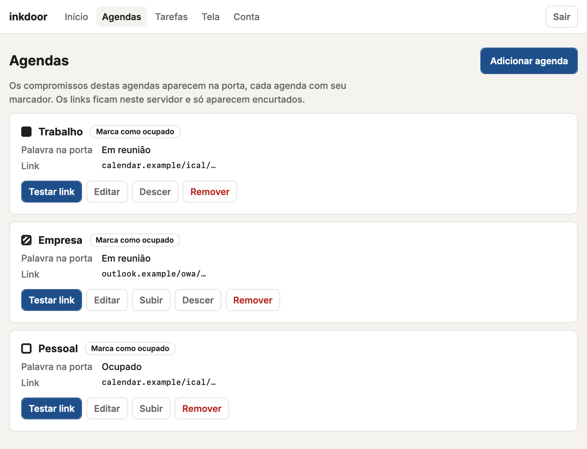

# Rodando o inkdoor num servidor de casa

[English](../server.md) · **Português (Brasil)**

O `inkdoor serve` precisa ficar rodando o tempo todo: quando ele para, o Kindle para de
atualizar. Um notebook que dorme à noite não é um bom lugar para ele. Um servidor de casa é
melhor, e o inkdoor é leve: um processo Python pequeno, que usa menos de 100 MB de RAM e cerca
de 1 GB de disco, já contando o sistema operacional.

- **Proxmox VE**: um comando cria um container com tudo pronto. [Ir para lá](#proxmox-ve).
- **Qualquer máquina Debian ou Ubuntu** (uma VM, um mini PC, um Raspberry Pi com sistema
  64 bits): [use o instalador](#debian-ou-ubuntu).

Nos dois casos, o resultado é o mesmo, e você configura o inkdoor pelo navegador, no
[admin](#admin):

| Caminho | O que é |
|---|---|
| `/etc/inkdoor/config.toml` | sua config, acessível só pelo usuário `inkdoor` |
| `/etc/inkdoor/admin-password` | a senha do admin, guardada como hash |
| `/opt/inkdoor` | o código e o ambiente Python |
| `/var/lib/inkdoor/kindle.png` | a tela gerada |
| `inkdoor.service` | o serviço do systemd, que sobe no boot e reinicia se cair |
| `/usr/local/bin/inkdoor` | roda o inkdoor com essa config: `inkdoor password`, `inkdoor check` |

## Proxmox VE

O `deploy/proxmox/create-lxc.sh` roda no host do Proxmox. Ele baixa o template mais novo do
Debian (o 13, ou o 12 em versões do Proxmox que ainda não aceitam o 13), cria um container sem privilégios (1 core, 512 MB de RAM, 4 GB de disco, ligado no
boot) e instala o inkdoor nele.

1. Abra um terminal no host do Proxmox: na interface web, selecione o nó e clique em
   **Shell** (ou entre por SSH como root).
2. Baixe o script e, se quiser, leia antes de rodar:

   ```sh
   curl -fsSLO https://raw.githubusercontent.com/frkey/inkdoor/master/deploy/proxmox/create-lxc.sh
   ```

3. Rode:

   ```sh
   bash create-lxc.sh --lang pt-BR
   ```

   Para levar o `config.toml` que você já tem, copie-o antes para o host (por exemplo
   `scp config.toml root@<ip-do-proxmox>:`) e acrescente `--config config.toml`.

4. No fim, o script mostra o endereço do admin e a senha, assim:

   ```
   Nova senha do admin: k7mq-x3vt-9hwp-r2nd  (salva em /etc/inkdoor/admin-password; ...)

   O inkdoor está rodando.
     Admin:  http://192.168.1.50:3667  (entre com a senha mostrada acima)
             ou http://inkdoor.local:3667 em computadores e celulares (o Kindle usa o IP)
     No Kindle, em inkdoor/config.sh:  URL="http://192.168.1.50:3667/kindle.png"
   ```

5. Abra o endereço do admin num navegador da mesma rede e entre com essa senha.
   Computadores e celulares também podem usar `http://inkdoor.local:3667` (o nome do container,
   anunciado na rede); o Kindle não entende esse tipo de nome, então ele usa sempre o IP.
6. Em **Agendas**, adicione os links das suas agendas ([onde encontrar](calendar-sources.md))
   e, depois de salvar, aperte **Testar link** em cada uma. A prévia em **Início** mostra a
   porta como o Kindle vai mostrar.
7. No Kindle, coloque `URL="http://<ip-do-container>:3667/kindle.png"` em
   `inkdoor/config.sh` ([configurando o Kindle](kindle.md)). A página inicial do admin mostra
   esse endereço com um botão de copiar.

Enquanto nenhum link for adicionado, a porta mostra uma tela de configuração com o endereço do
admin.

### Opções

| Opção | Padrão | |
|---|---|---|
| `--config ARQUIVO` | | `config.toml` a copiar para o container |
| `--lang en-US\|pt-BR` | idioma do sistema, senão `en-US` | idioma da tela numa config nova e das mensagens do script |
| `--ip dhcp\|CIDR` | `dhcp` | um endereço fixo, por exemplo `192.168.1.50/24` |
| `--gateway IP` | | seu roteador; obrigatório com `--ip` fixo |
| `--ctid N` | próximo ID livre | |
| `--hostname NOME` | `inkdoor` | |
| `--bridge NOME` | `vmbr0` | |
| `--storage NOME` | `local-lvm` | onde fica o disco do container |
| `--template-storage NOME` | `local` | onde fica o template do Debian |
| `--disk GB` | `4` | dá para aumentar depois com `pct resize <id> rootfs +1G` |
| `--memory MB` | `512` | |
| `--ref BRANCH_OU_TAG` | a versão mais recente | versão do inkdoor a instalar, por exemplo `v1.1.0` ou `master` |

O Kindle precisa achar o servidor sempre no mesmo endereço. Use um `--ip` fixo ou reserve o
endereço do container no roteador ("reserva de DHCP").

### No dia a dia

| Tarefa | Comando no host do Proxmox |
|---|---|
| Mudar a config | o admin, em `http://<ip-do-container>:3667` |
| Atualizar o inkdoor | `pct exec <id> -- env LC_ALL=C.UTF-8 bash /opt/inkdoor/deploy/install.sh` |
| Gerar uma senha nova do admin | `pct exec <id> -- inkdoor password` |
| Acompanhar o log | `pct exec <id> -- journalctl -u inkdoor -f` |
| Testar os links das agendas | `pct exec <id> -- inkdoor check` |
| Algo deu errado | [Solução de problemas](troubleshooting.md) |
| Editar a config na mão | `pct enter <id>` e depois `nano /etc/inkdoor/config.toml` |

O que você salva no admin atualiza a porta na hora. Edições feitas na mão valem a partir da
próxima atualização da tela; só uma `port` nova ou uma mudança em `[admin] enabled` precisam de
`systemctl restart inkdoor`.

A porta padrão é a 3667 ("DOOR" no teclado do telefone); antes era a 8000. Para saber qual
porta uma atualização vai usar, olhe a seção `[server]` do seu `config.toml`:

- **`port = 8000` ou `port = 3667`**: nada muda; o servidor continua nessa porta. Configs criadas
  a partir do `config.example.toml` antes da mudança têm `port = 8000`; instalações novas recebem
  a 3667.
- **Sem a linha `port`**: o servidor passa para a 3667 ao atualizar. Para manter a 8000,
  acrescente `port = 8000` dentro da seção `[server]` que já existe, antes de atualizar. Se não
  houver seção `[server]`, crie-a com a linha (uma linha no fim do arquivo ficaria na última
  seção e seria ignorada):

  ```toml
  [server]
  port = 8000
  ```

Para passar para a 3667 de propósito, mude `port` no `config.toml`, reinicie o serviço e atualize
a `URL` no `inkdoor/config.sh` do Kindle.

### Criando o container na mão

Se preferir criar o container pela interface web, deixe-o **sem privilégios** (unprivileged) e
com o recurso **nesting** ligado (os dois já vêm assim por padrão). O serviço roda num sandbox
do systemd, que não sobe sem nesting (status `226/NAMESPACE`). Depois, siga a próxima seção
dentro do container.

## Debian ou Ubuntu

O `deploy/install.sh` funciona no Debian 12 ou mais novo e no Ubuntu 22.04 ou mais novo, com
systemd. Como root:

```sh
curl -fsSLO https://raw.githubusercontent.com/frkey/inkdoor/master/deploy/install.sh
bash install.sh --lang pt-BR
```

Ele instala o Python, o git e o avahi (que anuncia a máquina como `<hostname>.local`) pelo apt,
baixa o inkdoor em `/opt/inkdoor` e cria o usuário
`inkdoor` e o serviço. Na primeira vez, cria o `/etc/inkdoor/config.toml` só com o `--lang`
escolhido, o fuso horário da máquina e o admin ligado: as agendas você adiciona no admin (cada
opção está explicada em `/opt/inkdoor/config.example.toml`). Depois gera uma senha do admin,
liga o serviço e mostra o endereço do admin e a senha. Continue a partir do passo 5 do Proxmox,
acima.

Para atualizar, rode `bash /opt/inkdoor/deploy/install.sh`. Ele baixa a versão mais recente (ou
o branch ou a tag que você passou antes com `--ref`) do mesmo repositório, instala os pacotes
Python nas versões exatas de `deploy/requirements.txt`, conferidos pelos hashes, e reinicia o
serviço. Sua config e sua senha do admin
nunca são sobrescritas; numa instalação de antes do admin existir, ele liga o admin uma vez e
mostra a primeira senha. Sem `--lang`, as mensagens saem no `language` da sua config.

Opções: `--lang en-US|pt-BR`, `--timezone Area/Cidade` (para uma config nova),
`--ref BRANCH_OU_TAG`.

## Admin

O admin é um pequeno site servido pelo `inkdoor serve` na mesma porta da imagem do Kindle.
Depois de entrar, você pode:

- **Início**: ver uma prévia da porta, o status, quando ela atualizou pela última vez e quais
  links estão falhando; atualizar na hora; copiar o endereço para o Kindle.
- **Agendas** e **Tarefas**: adicionar, editar, reordenar e remover agendas e o link do
  TickTick, e testar cada link. Um link salvo nunca volta a aparecer inteiro, só o começo dele.
- **Tela**: o modelo do Kindle, idioma, fuso horário, relógio, horário e dias do expediente, a menor folga a
  listar, intervalo de atualização. A porta aparece só para leitura: para mudá-la, edite o
  `config.toml` e reinicie o serviço.
- **Conta**: trocar a senha, sair.

<picture>
  <source media="(prefers-color-scheme: dark)" srcset="../img/admin-calendars-dark-pt-BR.png">
  
</picture>

Cada salvamento regrava o `config.toml` e guarda a versão anterior como `config.toml.bak`. Os
comentários do arquivo se perdem no primeiro salvamento; as opções que o admin não controla são
mantidas. Se o arquivo quebrar (por exemplo, depois de uma edição na mão), o admin mostra o que
está errado e oferece restaurar a versão anterior.

> **O admin usa HTTP simples, sem criptografia.** Quem consegue observar o tráfego da sua rede
> (uma visita no seu Wi-Fi, um aparelho invadido) pode ler a senha quando você entra e um link
> de agenda quando você cola, então use o admin só numa rede de confiança e nunca abra a porta
> dele no roteador.

### Senha

O instalador mostra a primeira senha. Para gerar outra (por exemplo, se você perdeu), rode
`inkdoor password` no servidor (num container do Proxmox: `pct exec <id> -- inkdoor password`).
Ele mostra a senha nova uma única vez e desconecta todos os navegadores. Também dá para trocar a
senha na página **Conta**.

### Abrindo o admin por nome

O admin, e também a imagem do Kindle, só respondem quando o endereço no navegador é um IP ou um
nome de rede local: um nome sem pontos, ou terminado em `.local`, `.lan`, `.home`,
`.home.arpa`, `.internal` ou `.localdomain`. Isso bloqueia sites que tentam chegar ao seu
servidor usando o próprio nome deles (DNS rebinding). Para usar outro nome, coloque-o no
`config.toml`:

```toml
[admin]
enabled = true
allowed_hosts = ["porta.example.com"]
```

Nomes do roteador ou da VPN que terminam num domínio público, como um nome da FRITZ!Box
(`inkdoor.fritz.box`) ou do Tailscale (`inkdoor.tail1234.ts.net`), também precisam estar na
lista: quem controla esse domínio poderia apontar um nome dele para o seu servidor.

Escreva cada nome exatamente como você digita no navegador, sem a porta e sem curingas. Um nome
com acentos ou outras letras fora do ASCII vai na forma ASCII (punycode, que começa com
`xn--`); uma entrada com porta ou com letras fora do ASCII aparece como erro na config. Se a
`URL` do Kindle usa um nome que não está liberado, a porta mostra uma tela
avisando.

### Num notebook

O `inkdoor serve` no seu próprio computador serve só a imagem do Kindle: um notebook entra em
redes que você não controla. Para usar o admin nele, acrescente ao `config.toml`:

```toml
[admin]
enabled = true
```

Depois rode `inkdoor password`, reinicie o `inkdoor serve` e abra `http://<ip-do-computador>:3667`
(o `inkdoor url` mostra o endereço). Desligue de novo antes de levar o notebook para uma rede
em que você não confia.

## Segurança

- **Deixe tudo na rede local.** Nunca abra a porta no roteador (port forward): a imagem mostra a
  sua agenda. Se o servidor tem firewall, libere a porta só para a sua rede.
- Só o `/kindle.png` e o repositório KPM do Kindle (`/kpm.json`, `/kpm/inkdoor.kpkg`: os scripts
  do Kindle e o endereço deste servidor) são públicos; todas as outras páginas pedem o login do
  admin. O serviço roda
  com um usuário sem privilégios, num sandbox do systemd que só pode gravar em
  `/var/lib/inkdoor` e `/etc/inkdoor`.
- O `config.toml` guarda links secretos: quem tem esses links consegue ler suas agendas. Num
  servidor, ele e o arquivo da senha só podem ser lidos pelo usuário `inkdoor`.
- Quem entra no admin consegue fazer o servidor acessar endereços da sua rede local com
  **Testar link**, inclusive outros serviços no próprio endereço de rede do servidor; só os
  endereços de loopback (`127.0.0.1`, `localhost`) e link-local são recusados. É assim que
  funciona uma agenda num servidor da rede, como um Nextcloud, e esse risco é aceito, então
  guarde bem a senha.
- Os links das agendas são baixados pelo proxy configurado no ambiente do inkdoor, se houver
  (`HTTPS_PROXY`, `NO_PROXY`; no macOS, também o proxy do sistema), então ele funciona em redes
  que só chegam à internet por um proxy. A verificação de loopback e link-local acima usa o
  endereço da agenda como esta máquina o vê. Logins de um arquivo `.netrc` nunca vão junto com
  um link.
